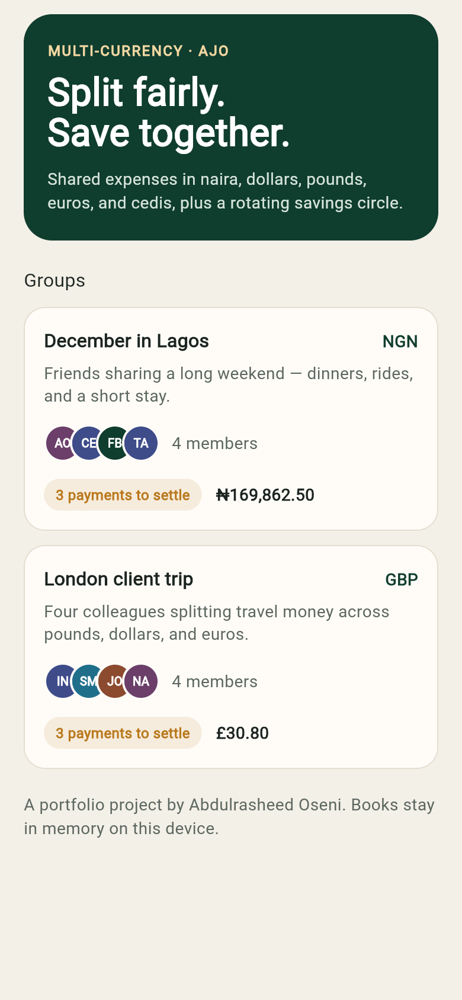
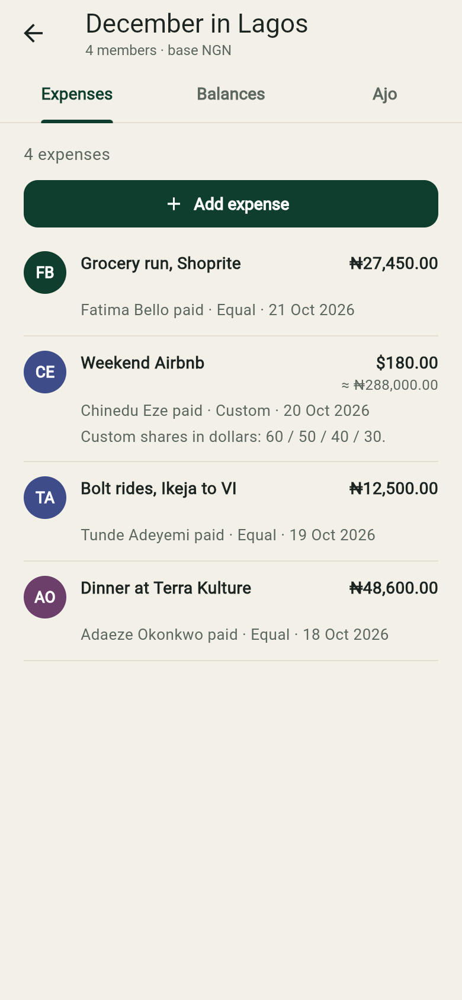
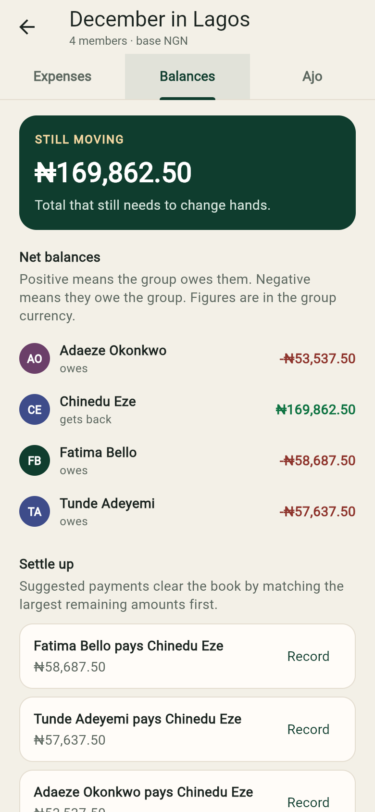
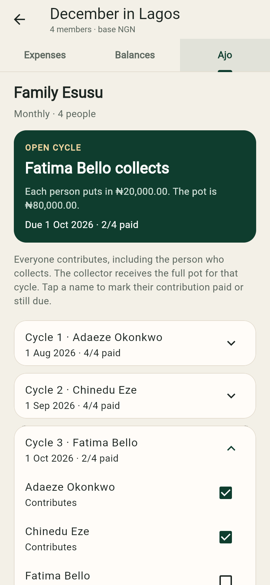
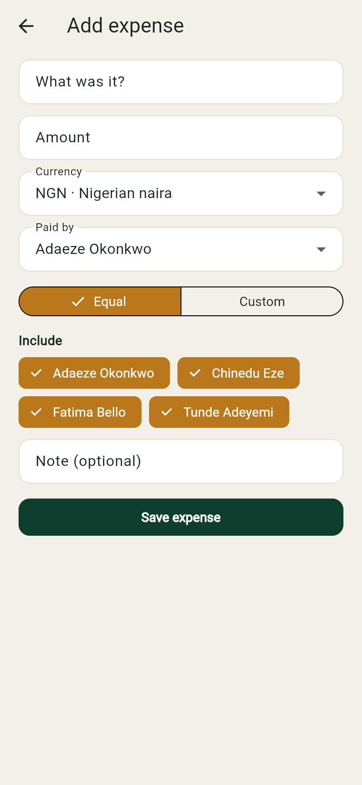
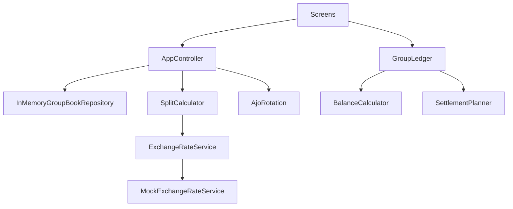

# Group Expense Splitter

A Flutter app for shared costs that do not fit in one currency, and for the rotating savings circles many people in Nigeria already run as Ajo or Esusu.

Friends split a dinner in naira, a stay in dollars, and a grocery run back in naira, then lose the thread of who covered what. Alongside that, an Ajo circle collects the same contribution every cycle and hands the pot to the next person in line. Spreadsheets drop the leftover kobo, mix up the exchange rate, and never show who collects next. This project keeps both ledgers on the device, with the split and rotation math covered by tests.

## Features

- Groups with members, a base currency, and a short description
- Expenses in NGN, USD, GBP, EUR, and GHS
- Equal splits, with leftover minor units given to the earliest people, and custom splits that must add up to the total
- A pluggable `ExchangeRateService`. The default `MockExchangeRateService` is offline and uses fixed demo rates
- Each expense stores its original shares and the converted shares in the group currency, adjusted so the book still sums to zero
- Net balances (positive means the group owes that person) and a greedy settle-up that suggests the payments to clear the book
- Recording a suggested payment updates the balances
- An Ajo/Esusu circle: contribution, pot, rotation order, due dates, who collects each cycle, and a paid/pending checklist
- Seeded sample data so the app opens on two lived-in groups instead of an empty screen
- In-memory storage behind `GroupBookRepository`, so a database can replace it later without rewriting the screens

## Screenshots

These are from the running app at phone width, using the seeded books. Nothing here is a mockup.



December in Lagos. The Airbnb stay is in dollars and shown again in naira at the demo rate.



Chinedu is owed the converted stay. Settle-up suggests three payments, largest debt first.



Family Esusu. Fatima collects the open cycle. August and September are fully paid.





## Tech stack

- Flutter 3.47 / Dart 3 (stable), null-safe
- `flutter_riverpod` for app state
- No backend and no API keys. Rates and books stay on the device

Demo rates are rounded fixtures, pivoted through naira, not live quotes:

| Currency | Naira per 1 major unit |
| --- | ---: |
| NGN | 1 |
| USD | 1,600 |
| GBP | 2,000 |
| EUR | 1,750 |
| GHS | 100 |

So $1.00 is ₦1,600.00 and £1.00 is ₦2,000.00. Cross rates are derived from those figures.

## Architecture

Screens talk to one `AppController`. The controller loads and saves an `AppState` through `GroupBookRepository` (the default implementation is `InMemoryGroupBookRepository` seeded by `SeedData`). Split, balance, settlement, and Ajo rules are pure functions, so the tests do not need widgets or storage.



Settle-up matches the largest remaining debt with the largest remaining credit. Ties break by member id, so the suggestion is stable. The absolute minimum number of payments is a harder problem; this is the practical greedy pass expense apps usually ship.

Ajo rotation wraps: cycle `n` is collected by `rotationOrder[n % length]`. Monthly dues clamp to the end of a short month, so 31 January steps to 28 or 29 February. Everyone contributes, including the collector, and the collector receives the full pot.

## How to run

Install the stable Flutter SDK (this repo was built with 3.47.9), then:

```bash
flutter pub get
flutter analyze
flutter test
flutter run
```

`flutter run` targets whatever device or browser you have attached. `flutter run -d chrome` starts the web build. The first screen lists the seeded groups **December in Lagos** (naira, with a Family Esusu circle) and **London client trip** (pounds, with dollar and euro expenses and no Ajo circle).

## Project structure

```
lib/
  main.dart                          ProviderScope and app entry
  app.dart                           MaterialApp and theme
  core/currency/                     Currency list and ExchangeRateService
  core/formatting/                   Minor-unit formatting and parsing
  data/                              Repository port, in-memory store, seed data
  features/groups/models/            Member and ExpenseGroup
  features/expenses/models/          Expense, Settlement, Transfer, SplitMode
  features/expenses/logic/           Split, balances, settle-up, GroupLedger
  features/ajo/                      Ajo circle models and rotation schedule
  state/                             AppState, AppController, Riverpod providers
  ui/screens/                        Home, group (three tabs), add expense
  ui/widgets/                        Expense list, balances, Ajo panel, avatars
  ui/theme/                          Colors and ThemeData
test/                                Split, settlement, Ajo, seed, controller, widgets
android/ ios/ web/ linux/ macos/ windows/   Flutter runners
.github/workflows/ci.yml             flutter analyze and flutter test
```

## Roadmap

- Persist books with a local database behind `GroupBookRepository`
- A live rate feed that implements the same `ExchangeRateService`
- Create and edit groups, members, and Ajo circles in the UI
- Partial payments, instead of recording the whole suggested transfer
- Reminders before an Ajo due date
- Shared sync once there is an account model. This scaffold is offline on purpose

## Author

**Abdulrasheed Oseni** ([@maikama8](https://github.com/maikama8))

Built as a public portfolio project.

## License

MIT. Copyright (c) 2026 Abdulrasheed Oseni. See [LICENSE](LICENSE).
